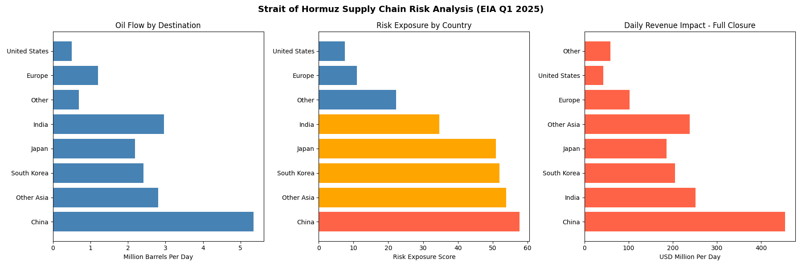
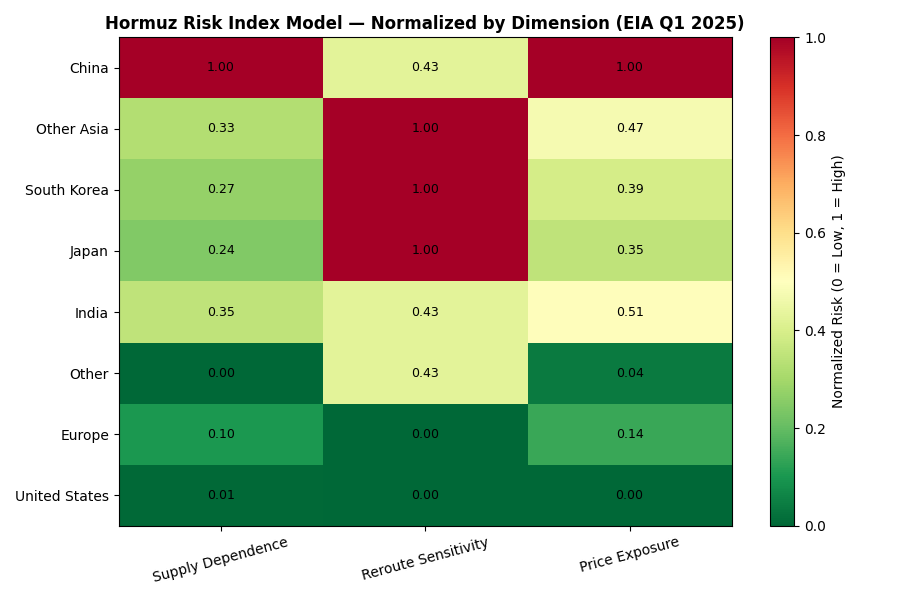

# 01 — Strait of Hormuz Supply Chain Risk Analyzer

## Overview
A quantitative risk analysis tool that models supply chain disruption scenarios
for a Strait of Hormuz closure and calculates cost, delay, and risk exposure
by importing country — built on real EIA Q1 2025 trade flow data.

## The Problem It Solves
The Strait of Hormuz carries approximately 20% of global petroleum consumption
daily. With disruption risk at its highest level in decades following the
Iranian Parliament's June 2025 closure proposal, energy procurement and
logistics teams need quantitative tools to model exposure and plan contingencies.

## How It Works
1. Ingests real oil flow data by destination country (EIA Q1 2025)
2. Models three disruption scenarios:
   - Partial Closure (25%) — threat-based slowdown, insurance costs spike
   - Full Closure (100%) — complete blockage based on June 2025 proposals
   - Cape of Good Hope Reroute — adds 15 days and $37.5M/day in shipping costs
3. Calculates barrels lost and revenue impact per country per scenario
4. Scores each country's risk exposure based on flow share and alternative supply availability
5. Assigns risk tiers (High / Medium / Low) using a weighted scoring model
6. Generates a three-panel visualization of flow, risk scores, and financial impact
7. Outputs a formatted analyst-style risk assessment memo

## Tools Used
Python, pandas, matplotlib

## Data Source
U.S. Energy Information Administration (EIA) — World Oil Transit Chokepoints, Q1 2025
https://www.eia.gov/international/analysis/special-topics/World_Oil_Transit_Chokepoints

## Real World Application
This type of scenario modeling is used by energy companies, defense contractors,
and consulting firms to assess geopolitical supply chain risk. Directly applicable
to roles in energy risk management, procurement strategy, and operations consulting
at firms like Colonial Pipeline, Booz Allen Hamilton, and Leidos.

## What I'd Do With More Data
- Incorporate live tanker tracking data from Vortexa or Kpler
- Add oil price elasticity modeling to project downstream consumer impact
- Expand to other chokepoints — Suez Canal, Malacca Strait, Bab el-Mandeb

## Output

## Risk Index Heat Map
