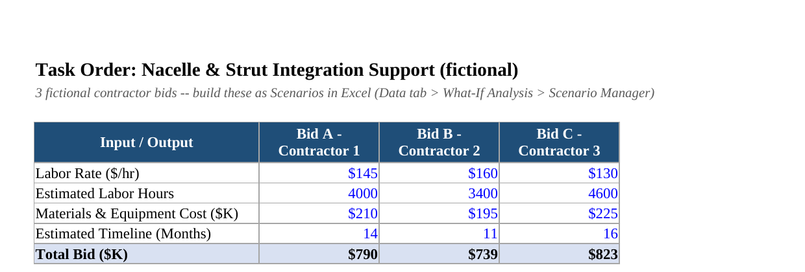

# Program Budget & Cost Variance Tracker

An Excel-based budget tracking tool built to practice the kind of cost variance analysis, 
contractor bid comparison, and budget-constrained decision-making used in government 
program/budget analyst and acquisition roles.

**[📥 Download the workbook](Program_Budget_Variance_Tracker.xlsx)** to explore the live formulas.

---

## Budget vs. Actual, with a live Scale Factor

Every category is a formula off a single Scale Factor cell — change it once, the entire 
program resizes instantly. Engine procurement running $35K over and Contingency Reserve 
getting drained (-75%) mirrors the real pattern GAO flagged in the B-52 CERP program 
(see Bibliography tab in the workbook).

## Contractor bid comparison, built for Scenario Manager

Three fictional bids on a task order, structured so they can be built out live as 
Scenarios in Excel (Data > What-If Analysis > Scenario Manager) to instantly toggle 
between them.

## What's inside the workbook

| Tab | What it does |
|---|---|
| **README** | Full write-up of the project and what's real vs. fictional |
| **Budget Tracker** | Planned vs. actual spending, 5 categories, live Scale Factor |
| **Contractor Bid Comparison** | 3 bids, set up for Scenario Manager |
| **Goal Seek Setup** | Solves backward from a budget cap to the max affordable labor rate |
| **Bibliography** | Every real-world source, with live links |

## The scenario

This is a fictional sub-program ("Auxiliary Systems Support — B-52 CERP Integration") 
loosely modeled on a real, current story: the Air Force's B-52 Commercial Engine 
Replacement Program (CERP), which a July 2026 GAO report found running about $3 billion 
over budget with a 15+ month schedule delay. None of the dollar figures in this workbook 
are real program data — GAO's report doesn't disclose the program's internal budget at 
that level of detail. The scenario is built to be realistic in structure and pattern, 
not a reproduction of actual figures.

## Skills demonstrated

Linked-cell formula scaling, variance analysis (SUM, IF, percentage variance), Scenario 
Manager (What-If Analysis), and Goal Seek — all core to program/budget analyst and 
government acquisition work.