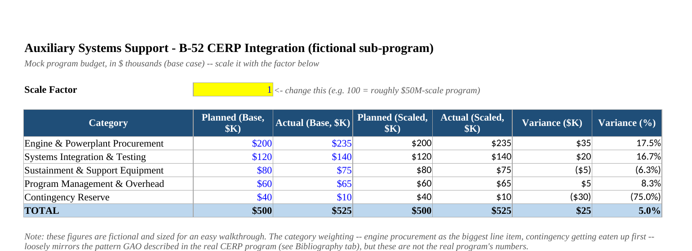

# Supply Chain & Program Analytics Portfolio

**Samuale Asefa**, Economics @ Towson University, Finance Track

---

Projects built on real data and real, current events, not toy datasets. Each README is 
upfront about what's real and what's a fictional exercise built for practice.

---

## Projects

<table>
<tr>
<td width="220"></td>
<td>

### [Program Budget & Cost Variance Tracker](03_budget_variance_tracker/)
Excel budget and cost variance tracker with contractor bid comparison, built for the kind of 
work government acquisition and program analyst roles do. Modeled on a real GAO report 
finding the Air Force's B-52 engine program running billions over budget.

**Tools:** Excel, Scenario Manager, Goal Seek
**Focus:** Government Acquisition, Program/Budget Analysis, Defense

**[📥 Download workbook](03_budget_variance_tracker/Program_Budget_Variance_Tracker.xlsx)**

</td>
</tr>
<tr>
<td width="220"></td>
<td>

### [Strait of Hormuz Risk Analyzer](01_hormuz_risk_analysis/)
Scenario model on real EIA trade data, quantifying the barrel and revenue impact of a 
partial or full shutdown of one of the world's most critical oil chokepoints.

**Tools:** Python, pandas, matplotlib
**Focus:** Risk Management, Energy, Consulting

</td>
</tr>
<tr>
<td width="220"></td>
<td>

### [Inventory Reorder Point Analysis](02_inventory_reorder/)
SQL-backed inventory system with pandas-driven reorder point calculations and automated 
purchase order alerts.

**Tools:** Python, pandas, SQL, matplotlib
**Focus:** Inventory, Procurement, Logistics

</td>
</tr>
</table>

---

## Skills Demonstrated

- Program budget variance tracking and Excel-based financial modeling
- Contractor bid comparison and cost/price analysis (Scenario Manager, Goal Seek)
- Supply chain risk modeling and scenario analysis
- Inventory optimization and reorder point calculation
- Data cleaning, transformation, and querying with pandas and SQL
- Geopolitical risk quantification using real EIA trade flow data
- Automated procurement alerts and purchase order logic
- Sourcing real government reporting (GAO, USASpending.gov) to ground projects in current events

---

*Each project folder has its own README with more detail.*