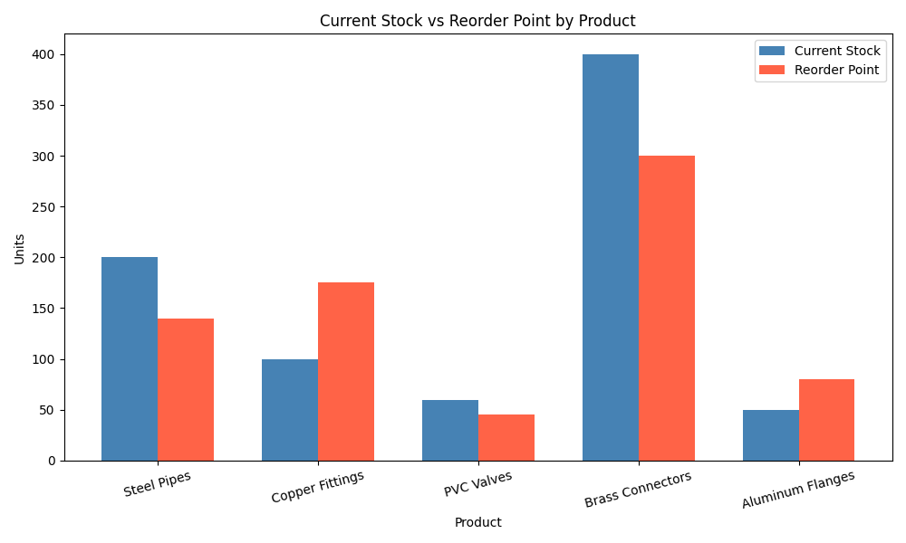

# Inventory Reorder Point Analysis

## Overview
This project analyzes product inventory levels and identifies items that need restocking before they run out. Built with Python, pandas, SQLite, and matplotlib.

## Business Problem
In supply chain operations, running out of stock before a replenishment order arrives causes costly delays. This tool automatically flags at-risk products and calculates exactly how many units need to be ordered.

## How It Works
1. Loads a product inventory dataset with demand rates, lead times, and current stock levels
2. Calculates the **reorder point** for each product using the formula:
   > Reorder Point = Daily Demand × Lead Time (days)
3. Flags any product where current stock has fallen below its reorder point
4. Calculates units needed to return to a safe stock level
5. Stores the dataset in a SQLite database and queries flagged items using SQL
6. Visualizes current stock vs reorder point for all products

## Tools Used
- Python
- pandas
- SQLite / SQL
- matplotlib

## Output

## Key Results
Two products were identified as needing immediate reorder:
- **Aluminum Flanges** — current stock below reorder threshold
- **Copper Fittings** — current stock below reorder threshold